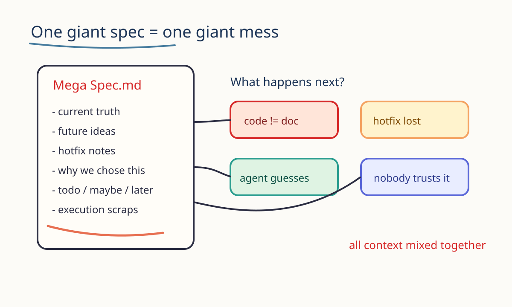
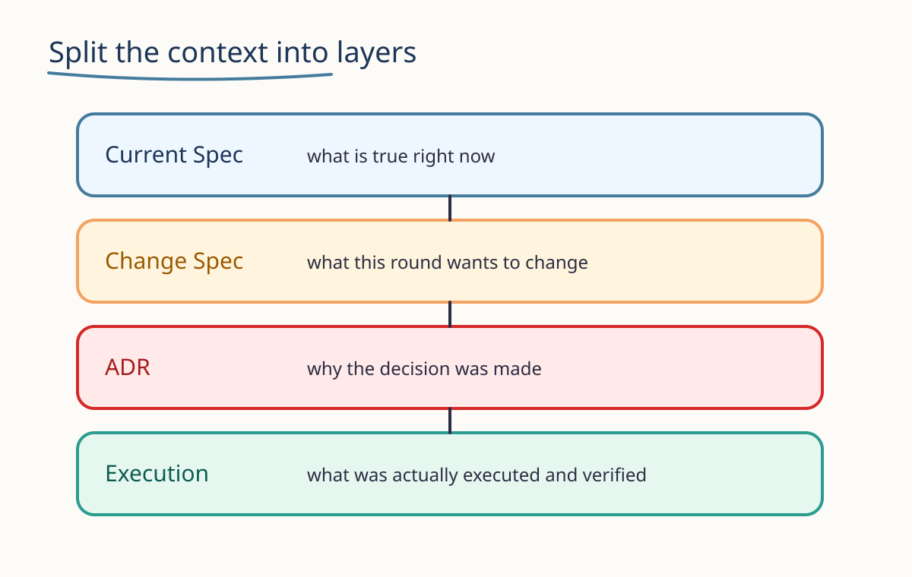
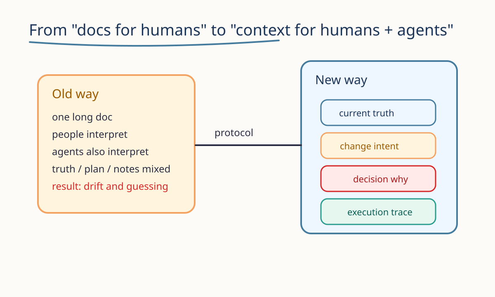

我以前对 spec 的理解，非常朴素，也非常天真。

大概就是：有需求了，写一份文档；要开发了，继续往上补；上线了，没时间整理；后面再有人来问“当时为什么这么做”，我就开始盯着屏幕发呆。

真的，不夸张。很多人对 spec 的想象，都是一份“只要我够努力，它就能包住一切”的总说明书。

但工程现实不是这样的。

- 需求会变
- 代码会漂
- hotfix 会插队
- 合并会丢信息
- 人会忘
- agent 也会被错误上下文带歪

所以问题不是“你写没写 spec”，而是：

**你是不是把所有信息都塞进了同一个桶里。**



## 一份 spec 为什么总会写着写着就失控

因为它天然在混四种完全不同的信息：

1. 当前系统到底长什么样
2. 这次到底想改什么
3. 当时为什么这么设计
4. 这次具体是怎么执行的

这四种东西，语气不同，时间维度不同，可信度也不同。

可我们经常干的事是：把它们全都塞进一个文档，然后期待这个文档既像需求、又像现状、还像会议纪要，最好顺便还能指导 agent 开发。

这时候灾难就来了。

你会看到这些熟悉场景：

- 文档里写的是新版方案，代码里跑的是半旧半新的版本
- 某个字段为什么保留，没人记得，只知道“别删，删了会炸”
- 线上刚 hotfix，spec 还没补，下一轮 agent 继续按旧上下文做事
- 某段实现已经被回滚，但文档还在激情描绘未来蓝图

我后来才反应过来：

**问题不是 spec 不重要，而是 spec 不能只有一种形态。**

## 真正能工作的 spec，至少要拆成四层

我现在更愿意把 spec 理解成一组上下文层，而不是一篇大作文。



### 1. Current Spec

它只回答一个问题：

**系统现在到底是什么。**

不是“我们打算做成什么”，也不是“产品经理希望它未来变成什么”，而是此时此刻，代码、接口、页面、规则，真实存在的样子。

它是当前真相。

agent 如果要做变更，先看的应该是它。  
不然就很容易出现一种很尴尬的情况：需求是新的，代码是旧的，agent 读了半天，最后理解的是一个平行宇宙。

### 2. Change Spec

它回答的是：

**这次要改什么，为什么改，影响到哪里。**

它不是全局真相，而是一次变更提案。

比如：

- 新增一个支付状态
- 调整 UI 的引导流程
- 修一个高优先级线上 bug
- 把一段旧逻辑逐步替换掉

它的重点不是描述整个系统，而是把“这次变化”单独建模。

### 3. ADR

ADR 最重要的价值，是留下那句未来会救命的话：

**我们当时为什么这样选。**

很多团队出问题，不是没有代码，也不是没有文档，而是没人记得当时为什么要绕这个弯。

比如：

- 为什么不是事件驱动而是定时补偿
- 为什么先保留双写
- 为什么 UI 先接受一次看起来不优雅的折中
- 为什么某个字段暂时不能删

当这些理由不被记录时，未来的每一次重构都像在拆盲盒。

### 4. Execution

Execution 不是未来计划，而是执行快照。

它记录的是：

- 这次谁做了什么
- agent 是怎么拆任务的
- 实际产出了哪些改动
- 哪些验收通过了
- 哪些问题留到了下一轮

很多人觉得 execution 不重要，但对 agent 协作来说，它很重要。

因为 agent 最怕的不是“没信息”，而是“拿到一堆已经过期却看起来很像最新真相的信息”。

Execution 的作用，就是把这次执行留下明确痕迹，避免变更历史全靠猜。

## 这四层不是形式主义，它们分别服务不同的问题

如果只用一句话总结，我会这样说：

- `current spec` 管现在
- `change spec` 管变化
- `ADR` 管决策原因
- `execution` 管执行结果

这四层不是为了写得好看，而是为了让上下文不打架。

对人来说，这是减少遗忘。  
对 agent 来说，这是减少幻觉式决策。

## 为什么这件事在 agent 时代更重要

以前文档乱一点，最多是人类同事来问你两次。

现在不一样了。

如果你开始让 agent 参与开发、拆任务、写测试、改 UI、补文档，那它读取上下文的方式，天然就是“看你给了什么”。

你把当前真相、未来设想、历史补丁、会议情绪，全糊在一起，agent 就很难知道：

- 什么是已经生效的
- 什么只是提议
- 什么只是解释
- 什么只是执行记录

于是它会开始自由发挥。

而自由发挥这件事，一旦进入代码、接口和页面，后果通常都不怎么优雅。



所以在 agent 时代，spec 不再只是“给人看的说明书”。

它更像一套**专门给人和 agent 共同消费的上下文协议**。

## 我现在更认同的结构

如果只保留最小骨架，我会先保留这四类：

```text
specs/
  current/
  changes/
  adr/
  execution/
```

然后让每次新需求、新补丁、新决策、新执行都去到自己该去的地方。

这时候 spec 才不会越写越胖、越胖越假、越假越没人信。

## 写到这里，其实还只解决了一半

把 spec 拆层，解决的是“别再把所有东西堆成一锅粥”。

但如果你再往前走一步，想让这套东西真的支持后续工程协作，你很快就会碰到新的问题：

- 一次明确交付对象怎么定义
- UI 这层真相怎么单独建模
- agent 的职责边界怎么写清楚
- 哪些高频结构应该被抽成模板

也就是：

**spec 不只是分层，还要开始形成 target、UI spec、spec agent、UI agent、template 之间的协作关系。**

这就到了下一篇要讲的内容：
[《SpecOS：当 Spec 开始长出 Target、UI Agent、UI Spec 和 Template》](./specos-target-ui-agent-ui-spec-spec-agent-template.md)。
