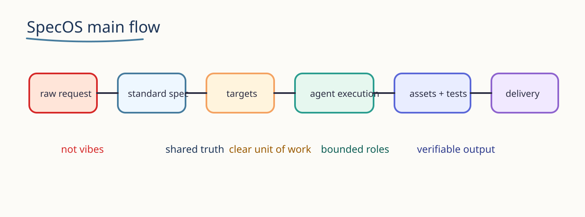
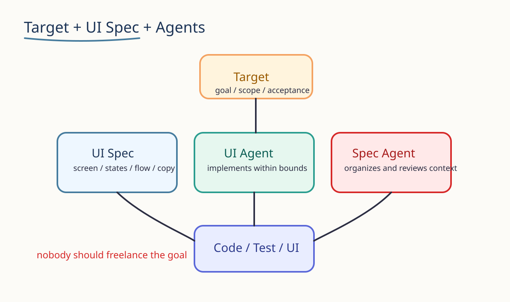
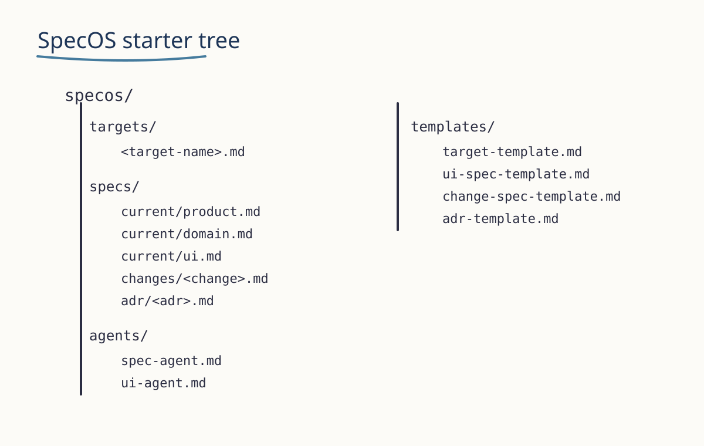

很多 AI 前端产出不稳定，不是模型太笨，而是输入太虚。

这类话对人都不稳定，对 LLM 更不稳定：

- “做高级一点”
- “好看一点”
- “优化一下 UI”
- “顺一点，丝滑一点”

LLM 不稳定理解“好看”，但稳定理解这四类信息：

- 状态
- 行为
- 反馈
- 约束

所以 UI 这一层要改写成一句更可执行的话：

**页面 = 状态 + 行为 + 反馈 + 约束。**



## 1. UI 不是感觉描述，是结构化输入

面向 LLM 的界面规格，不该写“这个页面是什么风格”，而该写“这个页面怎么运转”。

我会先固定 6 个字段：

- `User Goal`：用户想完成什么
- `Page Role`：页面承担什么职责
- `User Actions`：用户会做什么
- `System Behaviors`：系统如何响应
- `UI States`：界面有哪些状态
- `Feedback`：成功、失败、等待时怎么提示

这就是一份最小的 `frontend spec template`。

## 2. 一个页面，至少要写到这个粒度

不要只写“配镜首页”，而要写成：

- `User Goal`：输入眼睛参数，获得推荐
- `Page Role`：配镜入口和结果承接页
- `User Actions`：上传图片、切换账号、查看结果、选择支付
- `System Behaviors`：识别参数、轮询支付、成功跳转、失败重试
- `UI States`：`idle / loading / waiting / success / failed`
- `Feedback`：`toast / modal / inline error / skeleton`

差别在于：前者是标题，后者才是可执行上下文。



## 3. UI Spec 的职责要收紧

`UI spec` 不该泛化成一切 UI 讨论，它只负责界面层真相。

最少字段：

- `screen`
- `user-flow`
- `states`
- `components`
- `copy`
- `edge-cases`
- `acceptance`

它回答的不是“这个页面漂不漂亮”，而是：

- 用户从哪里进
- 会做什么动作
- 系统如何响应
- 页面经过哪些状态
- 哪些异常要处理
- 什么算完成

## 4. Spec Agent 和 UI Agent 要分开

这条链路我会明确拆开：

```text
Spec Agent
  ↓
UI Spec
  ↓
UI Agent
  ↓
React / Vue Code
```

- `Spec Agent`：整理原始需求，补齐缺口，输出结构化 spec
- `UI Agent`：消费 `target + UI spec + constraints`，产出页面和组件实现

不拆开的后果很直接：

- 同一个 agent 一边理解需求
- 一边改写需求
- 一边实现页面

最后你拿到的是产物，不是可审查过程。

## 5. Target 要先于 UI Spec

如果“这次到底交付什么”没写清楚，UI 很容易一路扩写。

一个最小 `target` 至少要有：

- `goal`
- `scope`
- `inputs`
- `outputs`
- `constraints`
- `acceptance`

没有 target，UI agent 很容易顺手扩大范围。

## 6. 术语才是真正的 UI 指挥语言

要减少 agent 脑补，不能只靠感觉词，要靠术语。

用户行为术语：

- `Primary Action`
- `Secondary Action`
- `Destructive Action`
- `Progressive Disclosure`
- `Interrupt Flow`

系统行为术语：

- `Optimistic Update`
- `Background Sync`
- `Polling Strategy`
- `Retry Strategy`
- `Graceful Degradation`

交互术语：

- `Empty State`
- `Loading State`
- `Error Boundary`
- `Skeleton Screen`
- `Inline Validation`
- `State Persistence`

页面结构术语：

- `Hero Section`
- `Control Panel`
- `Data Table`
- `Detail Drawer`
- `Sticky Action Bar`
- `Floating CTA`

这些词的价值不是显得专业，而是让你和 agent 引用同一套界面语义。

## 7. 最后沉淀成模板

如果这套写法不沉淀成模板，下一次还会退回“做得高级一点”。

最小骨架可以先是：

```text
specos/
  targets/
    <target-name>.md
  specs/
    current/ui.md
    changes/<change-name>.md
  agents/
    spec-agent.md
    ui-agent.md
  templates/
    target-template.md
    ui-spec-template.md
```



## 8. 一个很好用的动作

在让 agent 开工前，先丢一句：

`Ask me questions until you fully understand the UX.`

它如果问不出问题，通常说明它还没真正理解这套 UX。

## 结论

面向 LLM 写 UI，不要写感觉，要写状态。

展开就是四件事：

- 用 `状态 + 行为 + 反馈 + 约束` 描述页面
- 把页面收进 `frontend spec template`
- 把 `Spec Agent` 和 `UI Agent` 的职责拆开
- 用 `target + 术语 + 模板` 限制脑补空间

这样 AI 不是在猜你想要什么，而是在执行你已经说清楚的界面语言。
