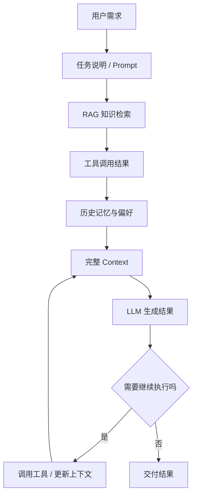
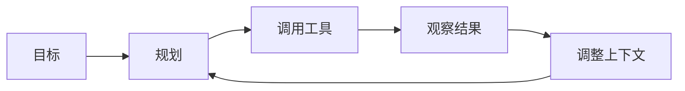

有时候我会觉得，程序员这个职业有点像修仙。

只不过以前修的是：

- Java
- Go
- 数据库
- Linux
- 分布式系统

而现在，整个修炼体系突然被改写了。

从 2023 年开始，AI 技术几乎以一种失控的速度在进化。每天打开技术社区，总会看到新的词：

`Agent`、`RAG`、`Context Engineering`、`Skills`、`SubAgent`、`Spec`、`agents.md`。

刚开始的时候，我也很焦虑。

因为这些词看起来都很高级，但真正用起来的时候，又有一种很奇怪的感觉：

**好像什么都学了，但又好像什么都没掌握。**

后来我决定做一件很朴素的事：

回头重新整理一下过去两年 AI 开发里反复出现的概念。

看看它们到底是什么，为什么会火，又到底有没有用。

整理到最后，我发现一件很有意思的事：

这些看起来横空出世的技术，很多并不是完全不同的体系。

它们其实都在做同一件事：

**给 LLM 注入更合适的上下文。**

换句话说，这些所谓的 AI 新范式，本质上很大一部分都可以放进一个词里：

**Context Engineering，上下文工程。**

## AI 术语爆炸之后，我先把它们重新分了一遍

过去两年，AI 开发圈里反复出现的关键词，大概可以分成几类。

第一类是模型本身。

比如 GPT、Claude、Gemini、LLaMA、DeepSeek。

不管名字怎么换，底层问题都绕不开一句话：

**LLM 是一个根据上下文生成文本的系统。**

它并不是像人类一样“真的懂了”，而是通过海量训练数据，学会了极强的语言模式、结构模式和推理模式。

所以你会发现一个很有意思的现象：

当上下文很差时，它像一个一本正经胡说八道的实习生。

当上下文足够清晰时，它又会突然表现得像一个很靠谱的同事。

这也是我后来反复意识到的一点：

**模型能力当然重要，但你给它什么上下文，同样重要。**

## Prompt Engineering 只是第一层

最早大家关注的是 `Prompt Engineering`。

也就是怎么把问题问得更好。

比如：

> 你是一名资深 Go 架构师，请按步骤分析这个系统问题。

看起来只是多写了一句话，但结果经常会完全不一样。

于是很多人开始说：

**Prompt 是 AI 的编程语言。**

这句话有一定道理，但我现在会觉得，它只说对了一半。

因为真实的 AI 应用里，模型看到的东西不只有 prompt。

它还会看到：

- 系统提示词
- 用户问题
- 历史对话
- RAG 检索内容
- 工具调用结果
- 用户偏好与记忆
- 任务说明和执行规范

也就是说，prompt 只是上下文的一小块。

真正决定输出质量的，往往是整个 context。

所以我现在更愿意这样理解：

**AI 能力 ≈ 模型能力 × 上下文质量。**

模型能力是地基，但上下文设计决定了这栋楼到底能不能住人。

## RAG、Tools、Memory、Spec，其实都在补上下文

如果把这些概念拆开看，它们的目标会变得非常清楚。

`RAG` 是在补知识上下文。

LLM 不知道你的公司文档、产品说明、内部知识库和项目代码，所以我们需要先检索，再把相关内容塞进上下文里，让它基于这些材料回答。

`Tools` 和 `Function Calling` 是在补能力上下文。

模型本身不会查数据库、不会调接口、不会访问文件系统，但它可以决定调用哪个工具，再让程序把结果返回给它。

`Memory` 是在补历史上下文。

它让 AI 不只是一次性回答，而是能记住过去的偏好、决策、任务结果和长期状态。

`Spec`、`agents.md`、`skills.md` 这些文件，是在补任务上下文。

它们告诉 AI：

- 你是谁
- 你能做什么
- 你应该遵守什么规则
- 当前任务的边界在哪里
- 什么文件可以改，什么文件不能碰

这些技术看起来名字不同，但最后都会汇聚到同一个地方：

**LLM 的 Context Window。**

可以画成一个很简单的流程：



AI 最终做的事情，其实没有那么玄：

**构建上下文，喂给模型，生成结果。**

区别只在于：

**谁能构造出更好的 context。**

## Agent 让我意识到：AI 不只是回答问题，而是接任务

后来最火的词，应该就是 `Agent`。

我一开始对 Agent 的理解也很模糊，总觉得它像一个被包装过的聊天机器人。

但后来我慢慢发现，Agent 真正有价值的地方不是“会聊天”，而是：

**它开始从回答问题，变成完成任务。**

一个最简单的 Agent 循环通常是这样：



也就是说，它不只是给你一段答案，而是会围绕目标反复执行：

- 拆任务
- 找资料
- 写代码
- 跑命令
- 看结果
- 再修正

如果任务再复杂一点，一个 Agent 还不够，于是又出现了 `SubAgent`。

比如写一篇文章，可以拆成：

- Research Agent 负责收集资料
- Writer Agent 负责写初稿
- Editor Agent 负责润色
- Fact Guard 负责检查风险

这其实就是多智能体架构。

听起来很高级，但放到程序员熟悉的语境里，它也没有那么神秘：

**就是把一个大任务拆给不同角色执行，再用上下文把它们串起来。**

## 爆火的 AI 产品，赢的不只是模型

过去两年很多 AI 产品火起来，我以前第一反应总是：

它是不是用了更强的模型？

后来发现，很多时候真正拉开差距的并不是模型本身，而是三件事：

- 产品体验
- 传播方式
- AI 能力封装

很多用户其实不关心你底层用了什么架构。

他们关心的是：

- 我能不能马上用
- 结果是不是够直观
- 学习成本是不是够低
- 它是不是把复杂技术藏到了一个简单动作后面

这件事对程序员也有提醒。

AI 时代并不是“谁知道最多术语，谁就赢”。

更重要的是：

**谁能把复杂能力封装成稳定、可复用、可理解的流程。**

## 程序员需要第二层脚手架

以前我理解的开发脚手架，大概是这种东西：

```text
gin
gorm
redis
grpc
mysql
kafka
```

这些是系统架构层的脚手架，负责解决：

- 服务框架
- 数据存储
- 通信协议
- 系统稳定性

但 AI 出现之后，我越来越觉得程序员需要多一层东西。

我把它叫做：

**AI 协作层脚手架。**

这层不是替代原来的工程架构，而是让 AI 更好地参与开发过程。

它可能长这样：

```text
agents.md
spec.md
skills.md
tools.md
memory.md
```

这些文件并不是传统意义上的“项目说明文档”。

它们更像是：

**写给 AI 的工作说明书。**

以前我们写 README，是为了让人快速理解项目。

现在我们写 `agents.md`、`spec.md`、`skills.md`，是为了让 AI 快速进入工作状态。

## 我给自己定了一个 AI 自救计划

所以我给自己定了一个很简单的目标：

做一套属于自己的 AI 开发脚手架。

大概结构是这样：

```text
ai-scaffold/

agents/
  coding_agent.md
  research_agent.md
  review_agent.md

skills/
  search.md
  code.md
  test.md

prompts/
  coding_prompt.md
  review_prompt.md

specs/
  current.md
  change.md
  execution.md

rag/
  knowledge_base/

runtime/
  go-agent/
  python-agent/
```

我的理解是：

- Go / Python 负责系统运行
- Prompt / Spec 负责上下文设计
- Tools / Skills 负责能力扩展
- Memory / RAG 负责知识和历史

以前我们开发系统，流程大概是：

```text
需求
↓
设计
↓
写代码
```

而现在，很多开发工作正在越来越像：

```text
需求
↓
写 Spec
↓
设计 Context
↓
AI 执行任务
↓
人类验收和修正
```

代码当然还是重要。

只是代码越来越像最后一步。

前面的关键，变成了你能不能把任务讲清楚，把边界划清楚，把上下文组织清楚。

## 我最后得到的结论

如果说以前程序员的核心能力是：

- 算法
- 架构
- 系统设计
- 工程经验

那么 AI 时代多了一项新能力：

**上下文设计。**

谁能设计更好的 context，谁就能让 AI 做更多事情。

这不是说程序员不需要写代码了。

恰恰相反，越是让 AI 参与开发，人越需要知道：

- 什么结果是对的
- 什么方案是危险的
- 哪些上下文必须给
- 哪些信息会误导模型
- 哪些地方必须由人做最终判断

所以与其一直焦虑 AI 会不会取代程序员，不如先学会一件更具体的事：

**给 AI 写说明书。**

这大概就是一个菜鸟程序员的 AI 自救方式。

不是突然变强。

而是在浪打过来的时候，先给自己搭一块能站住的脚手架。
