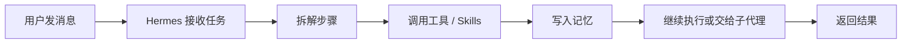
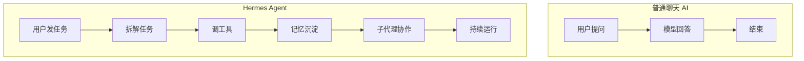

你可以把 Hermes Agent 理解成：**不是一个只会回你消息的 AI，而是一个可以常驻在服务器上、带记忆、会用工具、还能分身协作的 AI 打工人。**

它火，不是因为名字像希腊神话。它火，是因为它把很多人脑子里那句“要是 AI 能自己一直干活就好了”往前推了一步。

## 先说人话：它到底是什么

Hermes Agent 是一个 **self-improving AI agent**。  
翻译一下就是：它不是问一句答一句的聊天框，而是一个能持续运行、持续积累上下文、持续调用工具的智能体系统。

如果普通聊天 AI 像“随叫随到的顾问”，那 Hermes 更像：

- 住在你服务器里的实习生
- 你丢给它任务，它自己拆步骤
- 做完以后还能把经验记下来
- 下次再来，别的活也能接着干

它主打的不是“会说”，而是“会做”。

## 它和普通 ChatGPT / Claude 有什么区别

最简单的区别就一句：

- 普通聊天 AI：你问，它答
- Hermes Agent：你派活，它跑流程

Hermes 关心的不是“这句话怎么回得漂亮”，而是“这件事怎么做完”。

它通常会做这些事：

- 读取任务
- 拆解步骤
- 调用工具
- 记录结果
- 留下记忆
- 需要时再分给子代理并行处理

这就从“聊天”升级成了“工作流”。

## 它为什么能跑在服务器上

因为 Hermes 本身就是按 **可自托管** 的思路设计的。  
你可以把它放在 VPS、Docker、SSH 环境里，让它像一个长期在线的后台服务一样工作。

你可以把它想成这样：

它之所以适合服务器，不是因为“能跑起来”，而是因为它设计目标就是：

- 长时间在线
- 有状态
- 能接外部入口
- 能持续协作

## 最近为什么突然火

Hermes 最近被很多人关注，核心不是“又一个新 AI 名字”，而是它把几个很实用的能力揉到了一起：

1. **持久记忆**  
   它不只是临时反应，能把过程和结果留下来。

2. **工具和 skills**  
   它不是凭空瞎编，能接工具执行真实动作。

3. **子代理并行**  
   一个人干不完的活，可以拆给多个 agent。

4. **多平台入口**  
   不一定只在网页里玩，消息平台也能接。

5. **工具网关和自托管**  
   这让它更像一个能落地的系统，而不是一个演示页。

一句话总结：**它不是“更会聊天”，而是“更像一个可以被部署的 AI 系统”。**

## 图 2：普通聊天 AI vs Hermes Agent

## 小白怎么理解它的价值

别把 Hermes 想成“又一个聊天机器人”。  
你应该把它理解成：**AI 从“回答问题”走向“替你干活”** 的一个例子。

对普通开发者来说，它的意义主要有三个：

- 你开始看到 AI 不只是前台交互，而是后台执行系统
- 你会意识到 agent 不是玩具，是真能拼工作流的
- 你会开始思考：怎么把自己的任务拆成“人 + AI + 工具”的协作链

## 你可以先记住这一句

**Hermes Agent 的本质，不是更聪明，而是更能持续干活。**

这也是它像“能放到服务器上自己干活的 AI”的原因。

## 总结

如果你是第一次听 Hermes，只要记住三件事：

- 它是一个自托管 AI Agent
- 它能长期运行、带记忆、用工具、分身协作
- 它代表的是“AI 从聊天走向执行”的方向

下次再看到这种 agent 项目，别先问“它会不会聊天”，先问一句：

**它能不能真的把活干完？**
